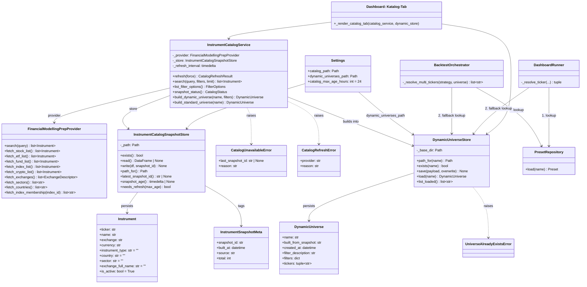
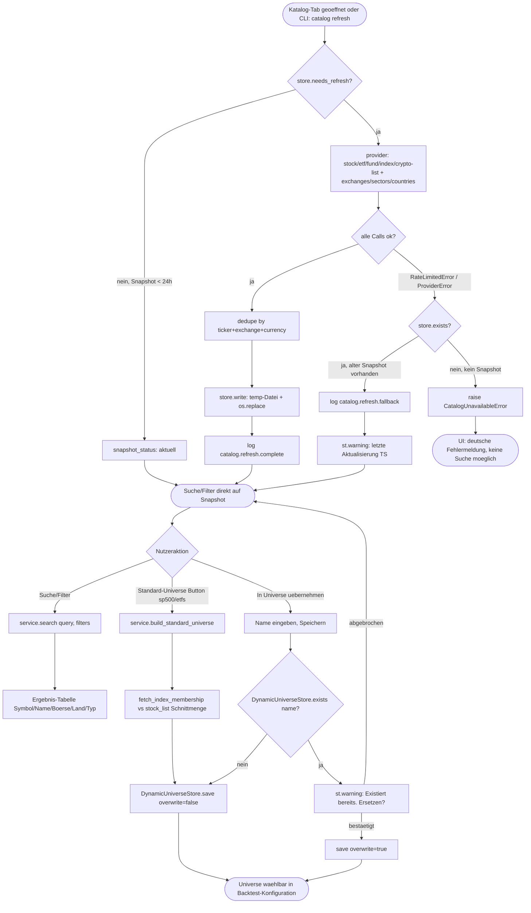
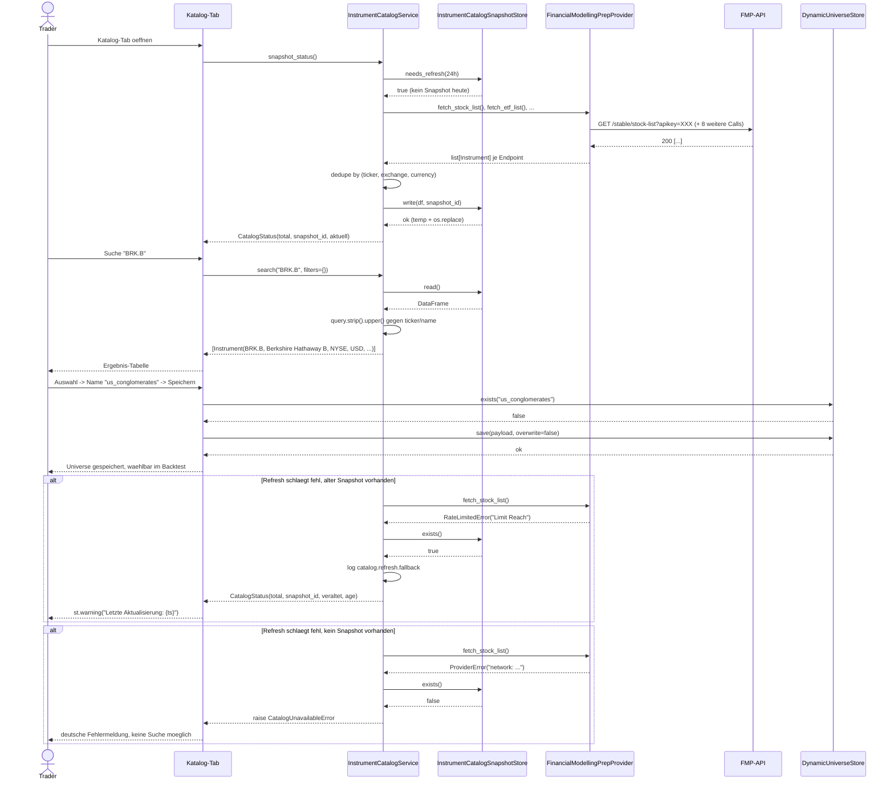

# UML: Slice 1.7 - Zentraler Instrumentkatalog und dynamische Universen

Status:    APPROVED
Phase:     P1 Datenlayer (Erweiterung)
Slice:     1.7 Instrumentkatalog und dynamische Universen
Approved:  2026-08-27

Mapped Requirements:
- NFR-Data-4: Taeglicher Instrumentkatalog mit Fallback auf letzten
  erfolgreichen Snapshot - DRAFT
- NFR-Data-3: FMP bleibt Primary Provider (Free-Tier 250 calls/Tag)
- NFR-Rel-1: Catalog-Refresh ist idempotent (Snapshot ersetzt, kein Append)
- NFR-Obs-1: Strukturiertes Logging (`catalog.*`, `universe.dynamic.*`)
- NFR-Ux-1: Deutsche UI-Texte im Katalog-Tab
- NFR-Sec-1: FMP-Key ausschliesslich aus `.env`

Stories:
- US-P1.10 Vollstaendigen Instrumentkatalog durchsuchen
- US-P1.11 Universen aus dem Katalog erstellen
- US-P1.12 Standard-Universen dynamisch aktuell halten
- US-P1.13 Taegliche Aktualisierung mit verlaesslichem Fallback

Referenz: ADR-0018, PRD `docs/prd/p1-data/instrument-catalog.md`.
Erweitert `FinancialModellingPrepProvider` (Slice 1.5, ADR-0009) und die
Universe-Resolution in `BacktestOrchestrator`/`DashboardRunner` (Slice 1.1).
`PresetRepository`/`UniverseStore` bleiben unveraendert erhalten.

## Structure

## Flow

## Sequence

## Notes

- Snapshot-Schreiben ist atomar (`temp` + `os.replace`), damit ein
  abgebrochener Refresh (z.B. Prozessabbruch waehrend `fetch_index_list`)
  nie eine halbe/kaputte Parquet-Datei hinterlaesst - `read()` sieht
  entweder den alten oder den vollstaendig neuen Snapshot, nie einen
  Zwischenstand.
- `needs_refresh` vergleicht `snapshot_age()` gegen
  `Settings.catalog_max_age_hours` (Default 24h); ein Refresh laeuft
  hoechstens einmal pro Tag automatisch, manuell jederzeit via
  `catalog refresh --force`.
- `DynamicUniverse.tickers` ist eine feste Momentaufnahme zum
  Speicherzeitpunkt (kein Live-Rebuild bei Katalog-Refresh) - konsistent
  zu bestehendem `UniverseStore`-Verhalten.
- `build_standard_universe("sp500"|"etfs")` nutzt denselben
  `save(overwrite=True)`-Pfad wie ein manuell gespeichertes Universe;
  `dax40` bleibt ausschliesslich in `PresetRepository` (kein FMP-Call).
- Resolution-Reihenfolge in `BacktestOrchestrator`/`DashboardRunner`
  bleibt `PresetRepository` zuerst, `DynamicUniverseStore` als Fallback -
  bestehende Backtests mit statischen Presets sind unveraendert.
- `CatalogUnavailableError` wird in der UI gezielt gefangen (deutsche
  Meldung); alle anderen `DataError`-Subklassen propagieren wie bisher.
