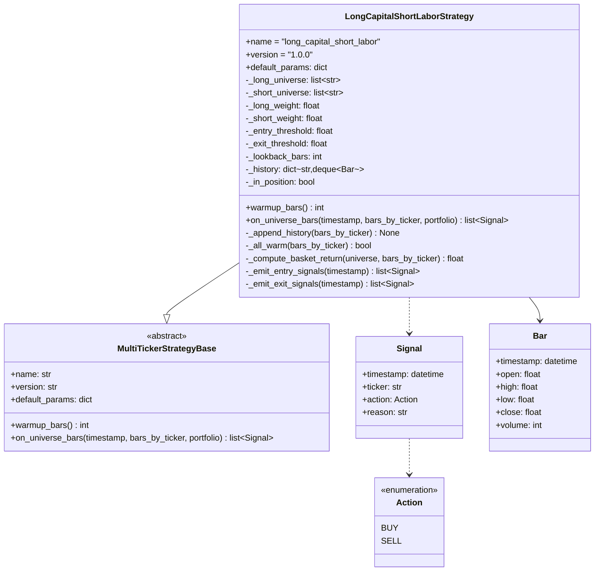
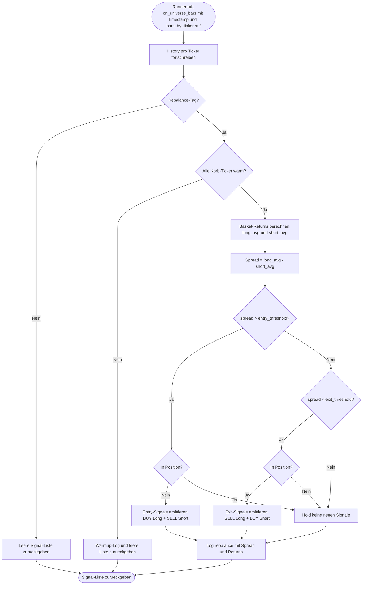
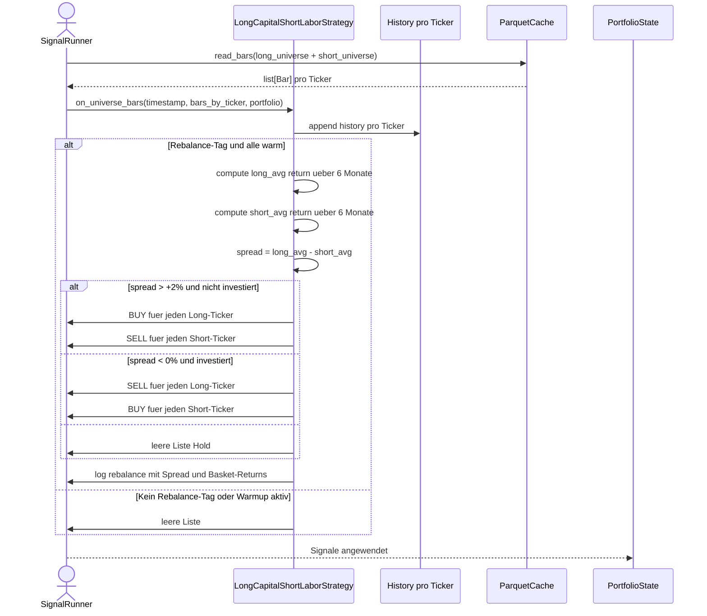

# UML: Slice 2.7 - Long Capital / Short Labor

Status:    APPROVED
Phase:     P2 Strategien
Slice:     2.7 Long Capital / Short Labor Strategie
Story:     US-P2.9 Long Capital / Short Labor als monatliches Pair

Mapped Requirements:
- NFR-Data-1: Cache-Pfad bleibt unveraendert
- NFR-Obs-1: Strukturiertes Logging der Spread-Berechnung
- NFR-Strategy-1: Determinismus (keine Randomness)

Die Strategie ist eine reine Erweiterung des bestehenden
Multi-Ticker-Frameworks. Sie veraendert weder die Registry noch
den Runner. Sie liest Bars aus dem bestehenden Parquet-Cache.

## Structure

## Flow

## Sequence

