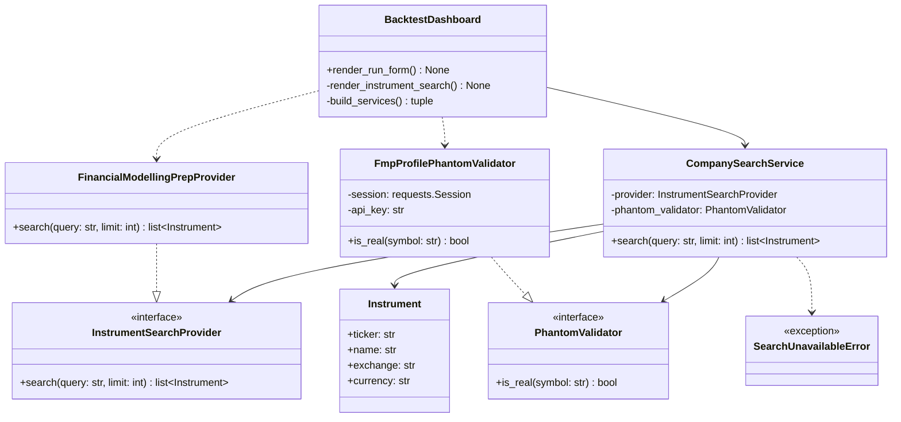
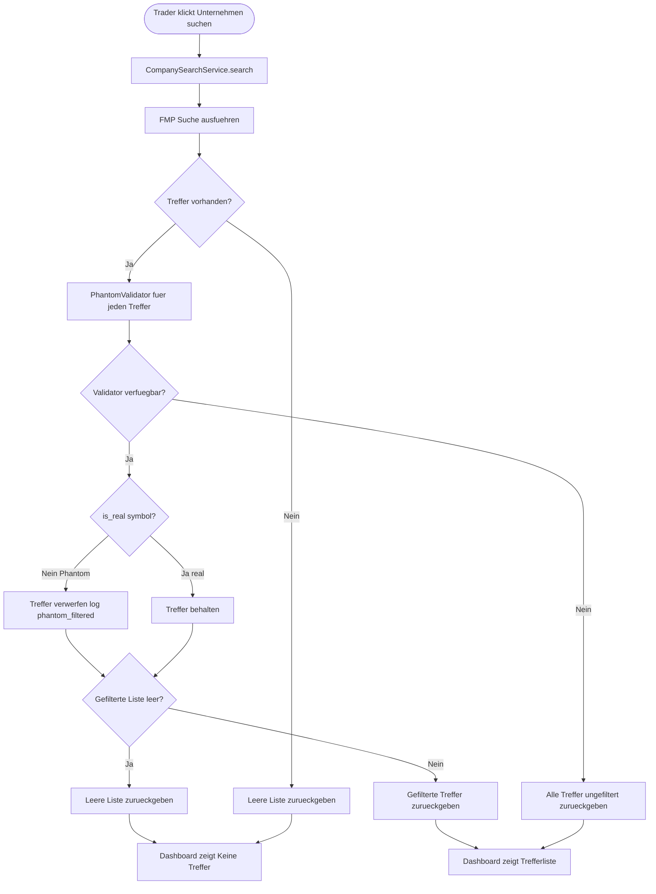
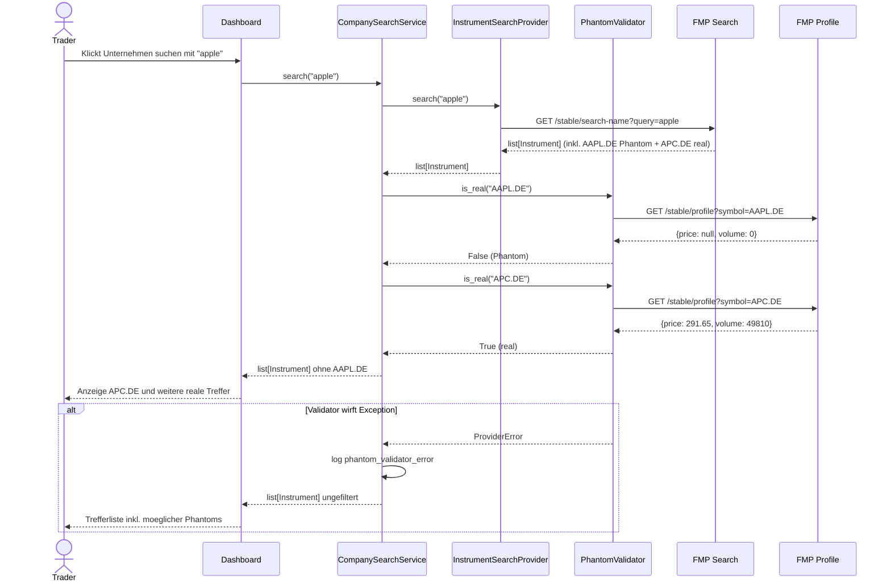

# UML: Slice 3.8 - Phantom-Ticker-Filter in der Suche

Status:    APPROVED
Phase:     P3 Backtest-Engine + Reports
Slice:     3.8 Phantom-Ticker-Filter in der Suche
Story:     US-P3.12 Phantom-Ticker aus Suche ausblenden

Mapped Requirements:
- NFR-Data-1: Cache-Pfad und Fallback-Kette unveraendert
- NFR-Sec-1: FMP-API-Key ausschliesslich aus `.env`
- NFR-Obs-1: Strukturiertes Logging entfernter Phantom-Treffer
- NFR-Ux-1: Bestehende deutsche UI-Texte und Fehlermeldungen

Der Filter wirkt ausschliesslich auf die Suchergebnisliste in
`_render_instrument_search`. DashboardRunner, BacktestOrchestrator,
ParquetCache und die Provider-Chain bleiben unveraendert.

## Structure

## Flow

## Sequence

